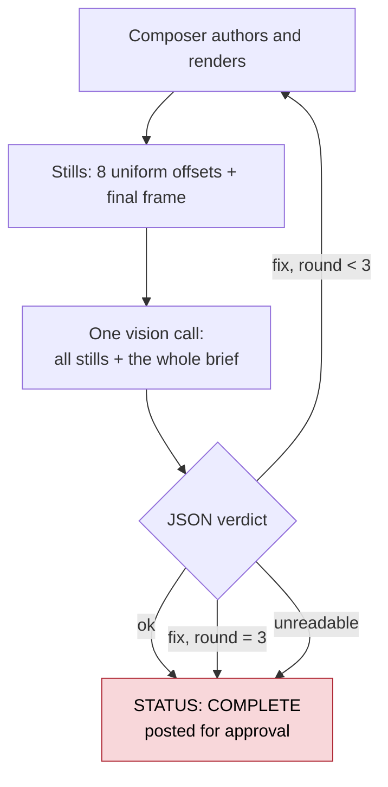
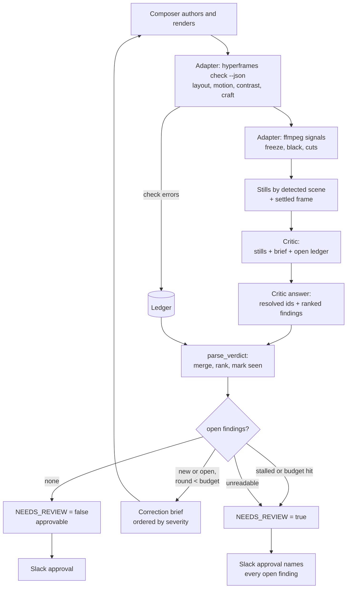
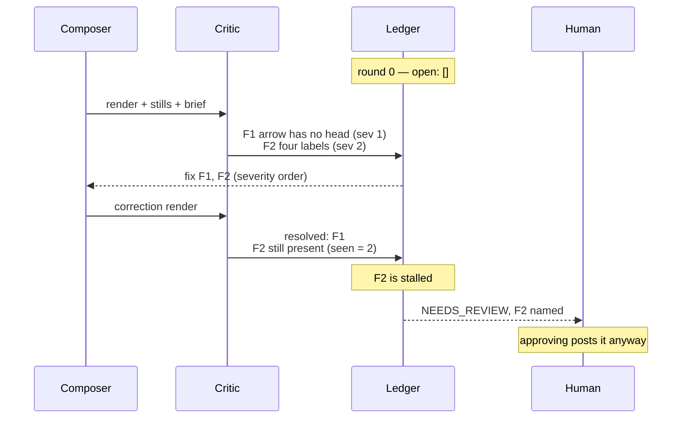
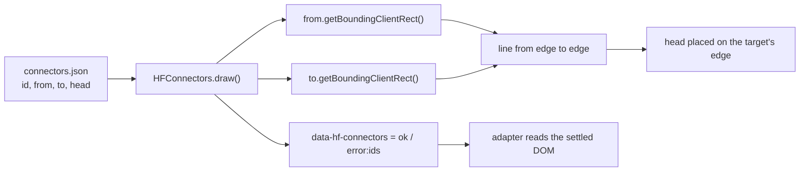
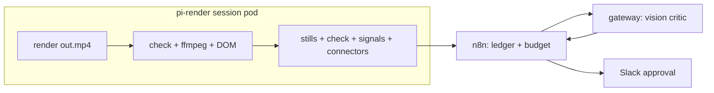

# Review flow

## Today, as execution 17510 showed it

Findings have no id, no severity and no memory, so each round is a fresh opinion. A `fix`
verdict is still an approvable asset, and an empty answer is read as a pass.

## After the change

## The ledger across turns

`seen` is the number of reviews that reported the same id. A finding seen twice survived a
correction turn, so it stops spending cycles and goes to a person instead of round three.

## Connectors as data

The composer no longer computes arrow coordinates. A head cannot point at nothing because the
target's own box decides where it lands; a missing endpoint is recorded as an error instead of
rendering as a line into space.

## Where each gate runs

The pod owns what only it can see (the artifact and the browser); n8n owns the decision and its
memory; the critic only judges what a still can show.
